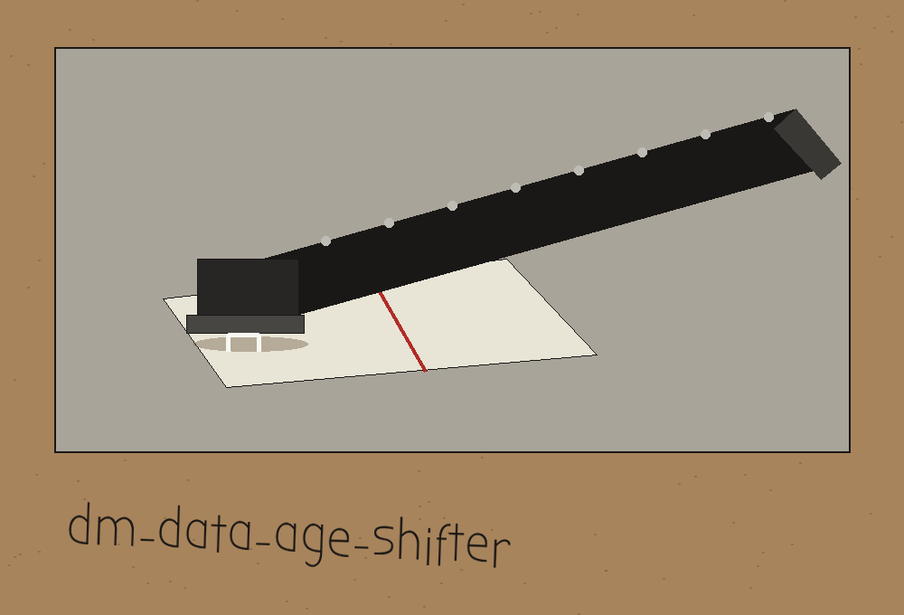
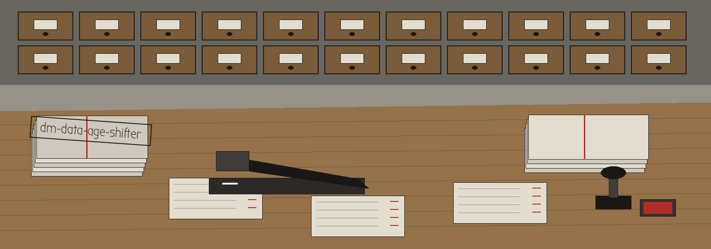

# dm-data-age-shifter

Title block: catalogue entry, author first. The name above is set in Bubbler One in ink black on newsprint grey, with a small date stamp image at the left of the block and the long arm stapler small beside the first heading only. Headings after that keep the catalogue form and the stamp position, with no stapler.

# dm-data-age-shifter
Shifts date and time fields in a dataset by a random interval within a specified range, preserving temporal relationships. One shift is drawn for the whole run and applied to every named date column, so gaps within a column and between columns are preserved. The signed shift is drawn from --min_days to --max_days as set, with no sign flip, and the applied shift is logged. - Focused on Tools designed to generate or mask sensitive data with realistic-looking but meaningless values

## Install
`git clone https://github.com/ShadowStrikeHQ/dm-data-age-shifter`

## Usage
`./dm-data-age-shifter [params]`

> Colophon slip: there is no seed, so no shift can be drawn twice. The log line is the only record of what a given run did.

## Parameters
- `-h`: Show help message and exit
- `input_file`: Path to the input CSV file
- `output_file`: Path to the output CSV file. It must not be the input file: if the output path resolves to the input file, the run refuses and exits 1 before any write.
- `--min_days`: Minimum signed number of days to shift the dates by. Defaults to 0.
- `--max_days`: Maximum signed number of days to shift the dates by. Defaults to 365.
- `--date_columns`: List of column names containing date/time values.  Separate multiple columns with spaces.

> Colophon slip: naming no columns warns but still writes a copy, with the dates unchanged.

## Failure rules
- If any named date column is not found, the run exits 1 and writes no output. With no --date_columns at all, the run still logs a warning that no dates will be shifted.
- A non-empty value in a named date column that does not parse as a date refuses the run: the run exits 1 naming the column, the count, and the CSV rows, instead of blanking the value. Empty cells may remain empty.

> Colophon slip: bad values are refused with their rows named, never blanked quietly.

> Colophon slip: output dates change their written shape. They come out in the pandas default datetime form, not in the shape they went in.

## License
Copyright (c) ShadowStrikeHQ

## Colophon notes, gathered at the table

The main button of this re-skin reads Shift Every Named Date. The range labels read Earliest Shift, in Days and Latest Shift, in Days. The columns field label reads Date Columns, Separated by Spaces. Its headings read One Draw for the Whole Run, Gaps Do Not Move, Refusals End the Run, and Warnings Do Not. Four facts are entered once more at full size: the true working call is python3 main.py with an input CSV path, an output CSV path, and the date columns flag followed by one or more column names, with placeholders only and no real date printed; the requirements file names pandas at 2.1.0 or later and nothing else; the file is always read as if its first row were a header, with no flag to say otherwise; and the repository LICENSE file contains the MIT License, its holder line giving the pen name in full, then a parenthetical given name with a single initial, then the account handle, recorded here without reproducing the line or expanding the initial.
